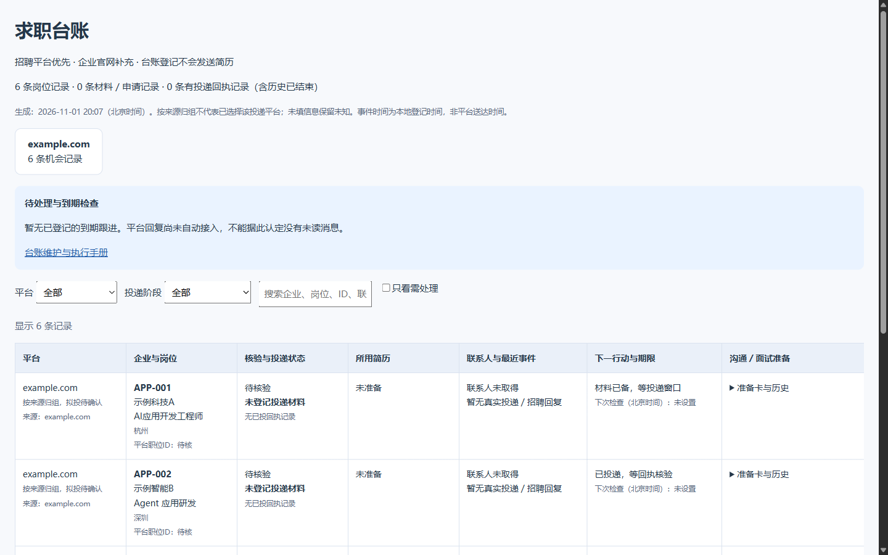
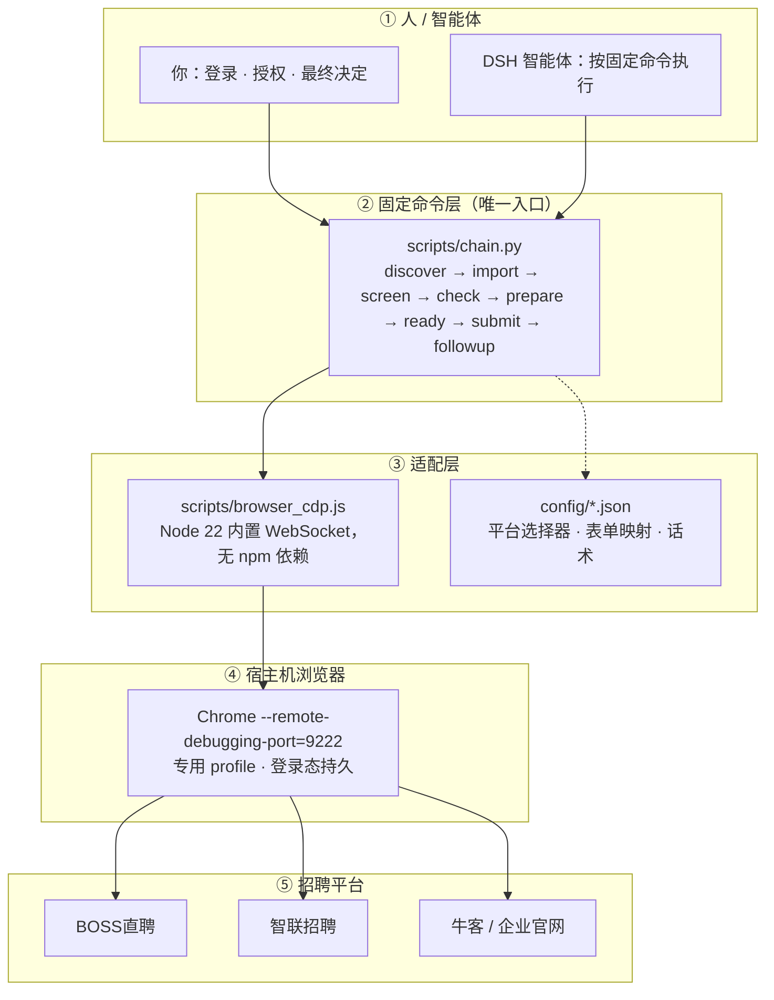
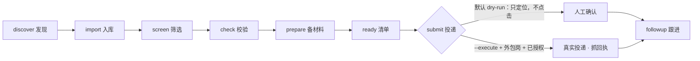
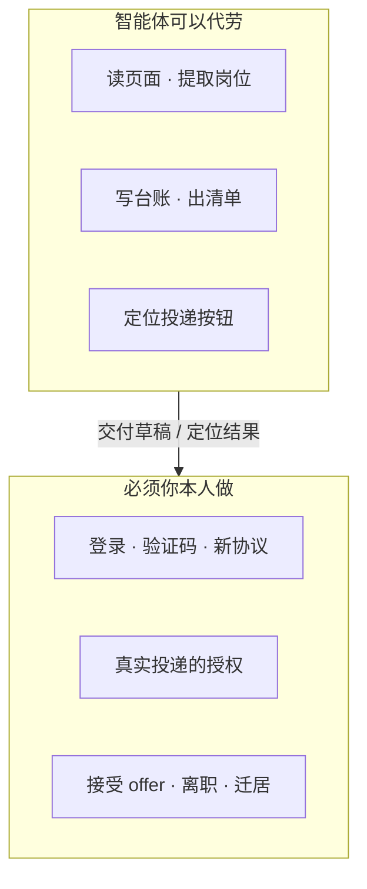

# OfferLoop

**帮你在招聘网站上「发现岗位 → 筛掉不合适的 → 整理成一份投递清单」。默认 dry-run：不真实投递、不自动打招呼，最后一步永远由你本人点。**

面向秋招 / 社招、手上有 DeepSeek Harness（或愿意自己敲命令）的人。把「每天刷招聘网站、一页页翻岗位、判断值不值得投」这些重复劳动交给它，你只做筛选判断和最后的决定。

## 最快：让 AI 一键启动（推荐）

1. 下载并安装 **DeepSeek Canis（DeepSeek Harness 桌面版）**，登录你的账户。
2. 新建一个会话，把下面这段提示词整段粘进去：

> 你是我的求职执行助手。仓库：https://github.com/yujinandyanhaoyang/offerloop
>
> 请从零帮我跑起来，全程 dry-run（不真实投递、不自动打招呼）：
> 1. 把仓库克隆到当前目录；
> 2. 按 `docs/DSH-上手.md` 复制 3 个 `*.example.json` 为真实配置；
> 3. 逐项问我并填好 `config/投递数据.json` 与 `config/当前检索范围.json`；`config/执行策略.json` 的 `external_actions_enabled` 保持 `false`；
> 4. 跑 `python -X utf8 scripts/chain.py status` 给我现状，再跑 `python -X utf8 scripts/chain.py run` 做一次全链 dry-run；
> 5. 需要浏览器时提示我启动 `scripts/browser_launch.cmd` 并自行登录平台，验证码 / 扫码由我来。
>
> 缺 Python 3.11+ / Node 22+ / Chrome 的话，先告诉我怎么装。

3. AI 会自己 clone、问你个人信息、填配置、跑通 dry-run。**你只需要回答问题**，真实投递最后仍由你本人点。

---

## 手动 3 步（不想用 AI 时）

> 前置：Python 3.11+、Node.js 22+、Google Chrome。脚本只用标准库，**不需要 `pip install`**；DeepSeek Harness（DSH）可选，想用智能体替你执行时才需要。

```powershell
# 1. 获取仓库
git clone https://github.com/yujinandyanhaoyang/offerloop.git
cd offerloop

# 2. 复制 3 个配置模板，填上你自己的信息
Copy-Item config\投递数据.example.json     config\投递数据.json
Copy-Item config\执行策略.example.json     config\执行策略.json
Copy-Item config\当前检索范围.example.json config\当前检索范围.json

# 3. 先看一眼现状（只读，不需要浏览器）
python -X utf8 scripts/chain.py status
```

`status` 会告诉你：台账里有多少岗位、有几条待办、浏览器有没有连上。**第一次跑 `jobs_total: 0` 是正常的**——还没发现岗位。

想跑完整链路：

```powershell
# 先在桌面双击 scripts\browser_launch.cmd 启动带调试端口的 Chrome，登录 BOSS/智联，
# 让已登录的标签停在搜索结果页；然后：
python -X utf8 scripts/chain.py run
```

`run` 会把「发现 → 入库 → 筛选 → 清单 → 投递计划」串一遍，**全程 dry-run、不产生任何真实投递**。跑完你会得到一份投递清单和本地台账（下面这张是演示数据）：



> 分步说明、配置逐项解释、真实投递前的检查清单，见 **[docs/DSH-上手.md](docs/DSH-上手.md)**（新人从这里开始）。

## 它帮你解决什么问题

| 你的困扰 | 它做什么 |
|---|---|
| 每天刷招聘网站、一页页翻岗位太累 | 直接读你当前打开的平台搜索页，提取岗位、公司、城市，整理成结构化列表 |
| 岗位太多，不知道哪个值得投 | 按「公司 C1–C5 / 岗位 J1–J5」检查项筛一遍，生成证据卡和按优先级排好的投递清单 |
| 想先小范围练手，怕误操作 | **默认 dry-run**：只定位按钮、不点击；真实投递只对「外包/派遣类」岗位开放，且必须你显式授权 |
| 每个平台都要重填一遍个人信息 | 姓名、学历、履历、简历文件只填一次（`config/投递数据.json`），多平台复用 |
| 投完就忘了跟进 | 台账记回执、状态；`followup` 列出活跃申请，可用邮箱辅助跟进 |

## 支持哪些平台

| 平台 | 已具备的能力 | 状态 |
|---|---|---|
| BOSS直聘 | 发现岗位、打招呼、投递（定位 + 抓回执） | 真实投递已验证跑通 |
| 智联招聘 | 发现岗位（含 SSR 列表）、投递（定位 + 抓回执）、在线简历 | 真实投递已验证跑通 |
| 牛客 | 岗位正文解析（服务端渲染页可直取全文） | 解析可用 |
| 企业官网 | 登录 / 岗位列表 / 投递选择器（`config/companies.json`，一家一个 key） | 适配器已配，按需增删 |

新增平台只改配置、不动主流程，见下方「配置模板」。

## 安全边界（先说清楚）

- **默认 dry-run**：`submit` / `apply` 不带 `--execute` 只定位按钮、不点击。
- **真实投递只限外包/派遣类岗位**：正编岗与「在考虑范围」岗只登记、不真实投递；判定是启发式，最终以实际劳动主体为准。
- **敏感字段不采集**：身份证号、护照、人脸/生物识别一律不采集、不填写、不入库。
- **人工保留项**：登录、验证码、新协议、接受 offer、离职、迁居，全由你本人处理。
- **频率与平台规则**：请自行遵守目标平台的用户协议与访问频率限制，不用于批量骚扰、爬取或自动登录。

## 想深入再看（按需）

- [docs/DSH-上手.md](docs/DSH-上手.md)：从零到首次 dry-run 全闭环、配置逐项说明、真实投递检查清单
- [docs/能力手册.md](docs/能力手册.md)：三个通用能力（打招呼 / 投递 / 更新简历）、命令速查、平台适配状态
- [docs/海投链路.md](docs/海投链路.md)：主链路与投递闭环的命令、产出与前置后置
- [docs/RUNBOOK.md](docs/RUNBOOK.md)：各阶段怎么跑、什么时候停
- [docs/岗位筛选规则.md](docs/岗位筛选规则.md)：公司与岗位过滤器（C1–C5 / J1–J5、分阶段取证）
- [docs/通用打招呼话术.md](docs/通用打招呼话术.md)：一套可复用的话术模板

## 它是怎么跑的（原理，感兴趣再看）



两个关键设计：

- **浏览器必须在宿主机跑，框架只做驱动。** 沙箱里起不了 Chromium，也不需要：Chrome 由你在桌面双击 `scripts/browser_launch.cmd` 启动，脚本通过 CDP 连接它。
- **登录态由 profile 持久化。** 登录一次，之后同一 profile 复用；验证码、新协议这类仍由你本人处理。

所以同一套框架，上层可以是 DSH 智能体，也可以是你手敲命令，行为完全一致。

### 一条命令走完一个招聘周期

`chain.py` 提供 `discover → import → screen → check → prepare → ready → submit → followup`，每步可单跑，`run` 可一次串起，默认全 dry-run：



## 用哪个模型（可选）

| 模型 | 角色 | 理由 |
|---|---|---|
| deepseek-flash | 按固定命令执行 | 平台选择器、表单映射、回执判定都封在配置里，flash 不需要理解平台细节，照 `chain.py` 步骤跑即可，便宜且快 |
| deepseek-v4-pro | 决策与审查 | 岗位取舍、背调结论、话术微调、跟进回复这类判断，交给更强的模型，并由你本人确认 |

一句话：**flash 干活，pro 拿主意，人做决定。**



## 配置模板

| 模板 | 复制为 | 作用 |
|---|---|---|
| `config/投递数据.example.json` | `config/投递数据.json` | 个人投递数据（定义一次，多平台复用） |
| `config/执行策略.example.json` | `config/执行策略.json` | 筛选 / 背调 / 执行策略与边界 |
| `config/当前检索范围.example.json` | `config/当前检索范围.json` | 岗位族 × 城市的检索范围 |

真实配置文件已写进 `.gitignore`，不会被误提交。适配器配置（`config/harness.json` / `platforms.json` / `companies.json` / `field_mapping.json`）是通用的，可直接用，也可按平台维护。

## 环境变量

| 变量 | 作用 | 默认值 |
|---|---|---|
| `OFFERLOOP_HOME` | 数据目录（台账 / 证据 / 回执 / 投递清单） | `<repo>/data` |
| `OFFERLOOP_CONFIG` | 项目配置目录（投递数据 / 执行策略 / 检索范围） | `<repo>/config` |
| `OFFERLOOP_ADAPTERS` | 平台适配配置目录 | 同 `OFFERLOOP_CONFIG` |
| `OFFERLOOP_OUTSOURCING_MARKERS` | 覆盖外包岗判定关键词（逗号分隔） | `外包,派遣,劳务,od,od外包` |

也可以把路径写进 `offerloop.local.json`（放在仓库根或其上级目录），优先级：环境变量 > `offerloop.local.json` > 默认值。

## 目录结构

```
offerloop/
├── README.md
├── LICENSE
├── CONTRIBUTING.md
├── .gitignore
├── scripts/        # 代码（chain.py / harness.py / pipeline.py / browser_cdp.js ...）
├── config/         # 配置（*.example.json 模板；真实配置 gitignored）
├── docs/           # 上手文档、能力手册、海投链路、RUNBOOK、岗位筛选规则、通用话术
├── tests/          # 测试
└── data/           # 运行时数据（台账 / 回执 / 投递清单，gitignored）
```

## 许可

MIT，见 [LICENSE](LICENSE)。

Copyright (c) 2026 OfferLoop contributors。可自由使用、修改、分发（含商业用途），前提是保留版权与许可声明。
