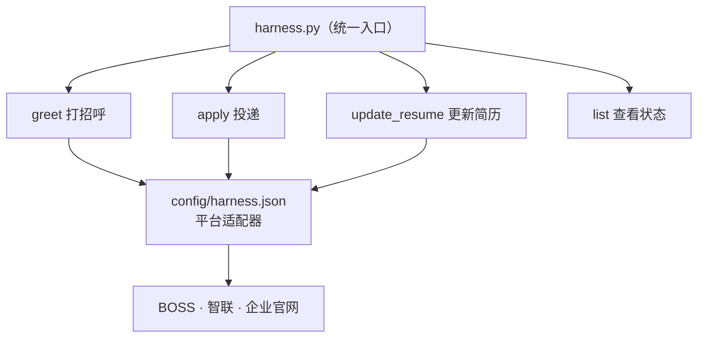

# 求职执行 Harness · 能力手册

本 harness 把求职执行收敛为**三个通用能力 + 平台适配器**。任何模型（含 DeepSeek-V4-flash）只需按本手册的固定命令调用 `harness.py`，**无需理解各平台 UI 细节**——平台的选择器与步骤都封装在配置里。



## 三个通用能力

| 能力 | 命令 | 说明 |
|---|---|---|
| greet 打招呼 | `harness.py greet <平台> <联系人> <消息>` | 给招聘方发消息 |
| apply 投递简历 | `harness.py apply <平台> <岗位ID>` | 把简历投给岗位（dry-run，见边界） |
| update_resume 更新简历 | `harness.py update_resume <平台>` | 填/改在线简历，数据取投递数据 |
| list 查看 | `harness.py list` | 列出能力、平台适配状态、边界 |

统一前缀：`python -X utf8 scripts/harness.py`

## 命令速查（示例）

```bash
# 打招呼（BOSS 已实测）
python -X utf8 scripts/harness.py greet boss "{联系人}" "您好，我对这个岗位有兴趣"

# 投递（dry-run 定位投递按钮，不真投）
python -X utf8 scripts/harness.py apply boss APP-xxx
python -X utf8 scripts/harness.py apply zhaopin APP-xxx

# 更新简历（示例企业官网已实测；智联结构已核实；BOSS 反爬阻塞）
python -X utf8 scripts/harness.py update_resume example

# 查看全部能力与边界
python -X utf8 scripts/harness.py list
```

## 数据（定义一次，多平台复用）

- **投递数据**：`config/投递数据.json`（姓名/性别/出生/手机/邮箱/教育/工作/简历PDF+照片/skip敏感项）。填表时作为唯一数据源。

## 配置文件（平台细节都在这，模型不读也不影响）

| 文件 | 作用 |
|---|---|
| `harness.json` | 三能力 → 平台适配器（选择器+步骤+状态），harness.py 读它执行 |
| `field_mapping.json` | 投递数据 → 各平台表单字段映射（update_resume 用） |
| `platforms.json` | 招聘平台岗位选择器/搜索/提交按钮（apply/greet 用） |
| `companies.json` | 企业官网（示例模板）登录/岗位/投递选择器 |

## 边界（硬约束，任何模型都必须遵守）

1. **敏感字段跳过**：身份证号、护照、人脸识别、生物识别——一律不采集不填写。
2. **人工保留项**：登录、短信验证码、新协议、接受 offer、离职、迁居——由本人处理，程序不代做。
3. **真实投递仅外包岗**：某外包派遣公司/某OD外包岗 可真实投递/打招呼测试；**正编与「在考虑范围」岗位只登记、不真实投递**。

## 平台适配状态（截至 2026-10-30）

| 能力 | BOSS | 智联 | 企业官网示例 |
|---|---|---|---|
| greet 打招呼 | ✅ 已实测（execCommand 发消息） | 待核实 | 待核实 |
| apply 投递 | ✅ 选择器已配 | ✅ 选择器已配 | ✅ button.submit |
| update_resume 更新简历 | ❌ 反爬阻塞 | ⚠️ 结构已核实，求职意向 s-cascader 改值阻塞 | ✅ 已实测 |

## 给 V4-flash 的最小操作指引

1. 想给某平台招聘方发消息 → `harness.py greet <平台> <联系人> <消息>`（仅外包岗）。
2. 想投某岗位 → `harness.py apply <平台> <岗位ID>`（dry-run；外包岗才可真实投）。
3. 想填某平台在线简历 → `harness.py update_resume <平台>`（数据已在投递数据.json）。
4. 遇到平台状态是「待核实/阻塞」→ 先 `harness.py list` 看状态，不要自行猜选择器，把待核实项补进 harness.json 再执行。
